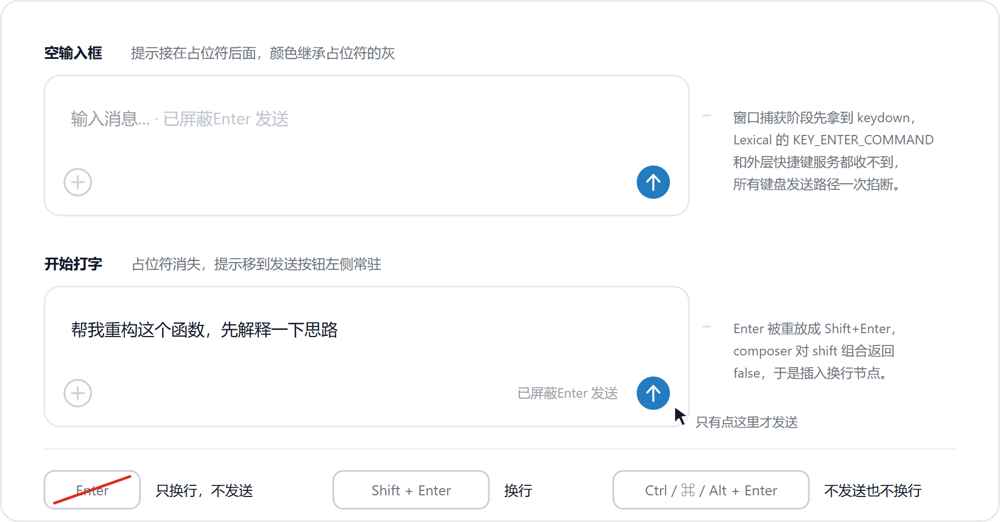

# dsh-no-enter-sand · 屏蔽 Enter 发送

一个只做一件事的 DeepSeek Harness Web 插件：**Enter 不再发送消息**。

- **Enter 变回换行键**：按 Enter 就是换行，和写文档一样。
- **只能鼠标发送**：消息只能点发送按钮发出去，任何键盘组合都不会触发发送。
- **输入框灰色提示**：输入框里以灰色显示「已屏蔽Enter 发送」，开始打字后提示会挪到发送按钮左侧常驻。



## 为什么需要它

DSH 的输入框默认是 Enter 发送、Shift+Enter 换行。写长 prompt、贴代码、或者在中文输入法里选词时，误按 Enter 会直接把没写完的内容发出去。这个插件把发送权完全交给鼠标，误发就不可能发生。

## 行为细节

| 操作 | 结果 |
| --- | --- |
| `Enter` | 换行 |
| `Shift` + `Enter` | 换行 |
| `Ctrl` / `Cmd` / `Alt` + `Enter` | 被吞掉，既不发送也不换行 |
| 小键盘 `Enter` | 同 `Enter` |
| 输入法组字中按 `Enter` | 交给输入法选词，不拦截 |
| `/`、`@`、命令菜单打开时按 `Enter` | 照常选中菜单项 |
| 输入框以外的 `Enter`（对话框、重命名、按钮） | 完全不受影响 |
| 点击发送按钮 | 正常发送 |

## 安装

在本 profile 里安装（工作区已有源码时）：

```
plugin_manager({ action: 'install_bundle', target: '<本目录绝对路径>' })
```

安装后刷新 Harness Web 页面即可生效；在「设置 → 插件」里能看到「屏蔽 Enter 发送」。

## 开发

```bash
npm test    # node test/harness.cjs —— 离线假 DOM 测试，不需要浏览器
npm run check   # node --check client.js
```

`test/harness.cjs` 用一个极小的假 DOM 把 `client.js` 跑在 `vm` 沙箱里，断言的核心契约是：Enter 一定被 `preventDefault` 且不会到达编辑器的发送逻辑、Enter 一定以 Shift+Enter 重放从而产生换行、组字与菜单场景一定放行、输入框之外的 Enter 一定不受影响、卸载后行为完全恢复。

## 实现要点

- **捕获阶段拦截**。输入框是 Lexical 编辑器，`KEY_ENTER_COMMAND` 在 contenteditable 根节点（冒泡阶段）处理，外壳的快捷键服务更靠上。插件在 `window` 上以 capture 阶段监听 `keydown`，先于两者运行，用一次 `preventDefault() + stopImmediatePropagation()` 就掐断了所有键盘发送路径，不必逐个追handler。
- **Enter 重放成 Shift+Enter**。DSH 的 Enter 处理器对 shift 组合返回 `false`，于是 Lexical 插入换行节点。插件用一个 `synthetic` 标志跳过自己重放的那一次，避免自噬。
- **只拦截编辑器区域**。事件目标先做 `closest('[data-composer-input]')`；如果目标是 `body`/`documentElement`（键盘事件没有落点时），退回用 `document.activeElement` 判断。因此对话框、重命名框、按钮上的 Enter 全部保持原生行为。
- **提示用两处，互不抢位**。输入框为空时，在 DSH 自己的占位符节点上挂 `::after`，继承占位符的灰色与位置，看起来就是原生 ghost text；一旦开始打字占位符消失，发送按钮左侧的常驻小字接手提示。
- **不碰哈希类名**。只使用稳定的 `data-composer-placeholder` / `data-composer-input` 属性和 `--dsw-*` 主题变量，Harness 升级重排样式也不会失效。

## 文件

```
client.js           浏览器端全部实现（拦截 + 换行 + 提示 + 样式）
index.js            host 半边，空实现（插件纯前端）
cordis.patch.yml    bundle patch，向组合插入本插件
locale/zh.json      中文标题与描述
locale/en.json      English title and description
icon.svg            图标
docs/preview.svg    行为示意图（源文件）
docs/preview.png    行为示意图（渲染结果，README 里引用）
test/harness.cjs    离线测试
```

## 许可

MIT
